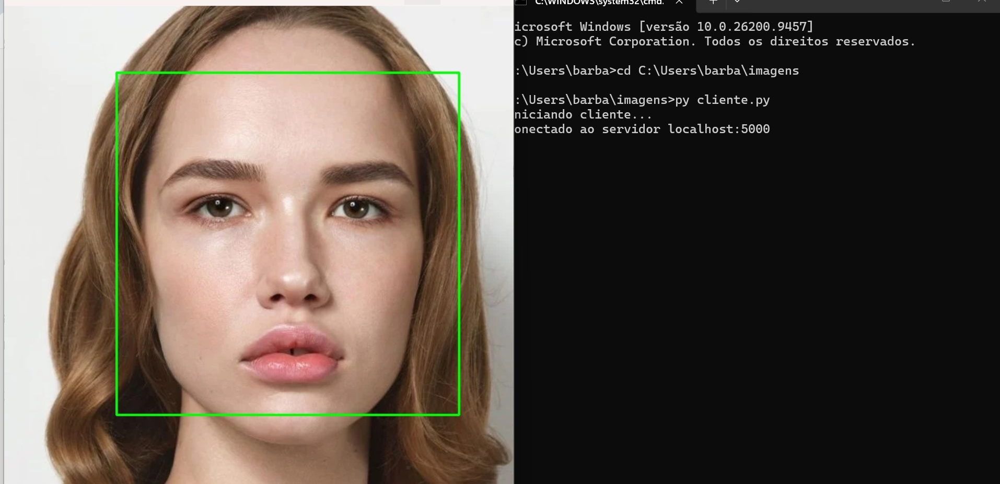
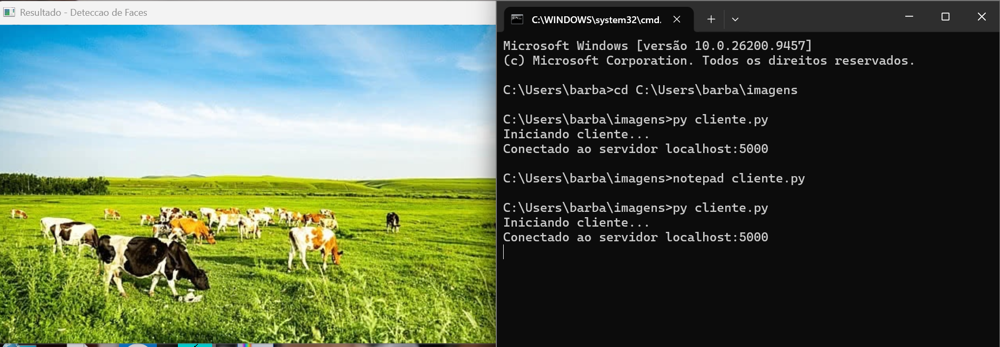
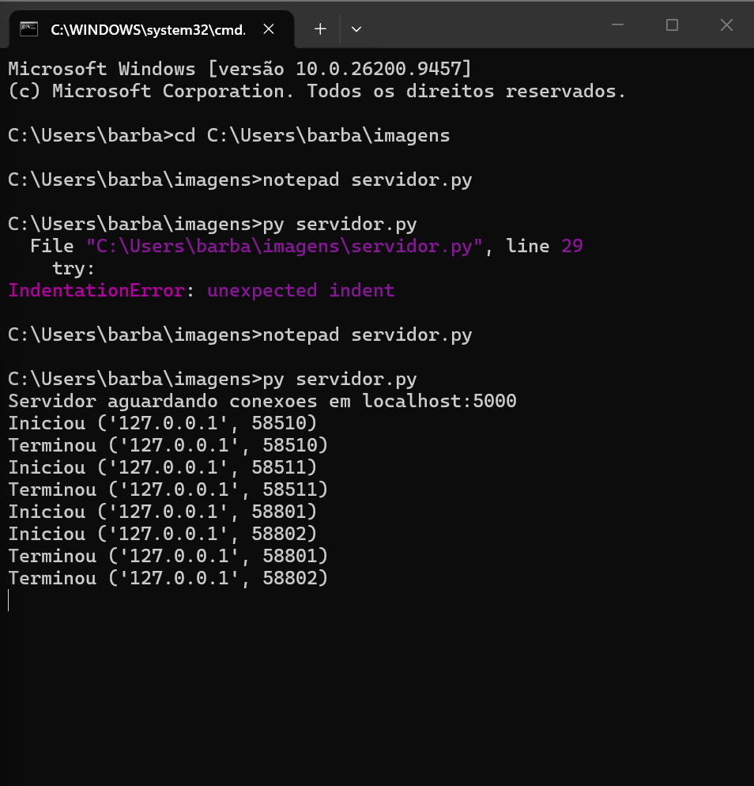

# Serviço Concorrente de Processamento de Imagens

**Disciplina:** Informática Industrial – ENE118  
**Integrantes:**
- [SEU NOME] – [sua matrícula]
- [NOME DO COLEGA] – [matrícula do colega]

**Divisão de tarefas:**
- [SEU NOME]: implementou `imagem.py` e `cliente.py` (branch `cliente`)
- [NOME DO COLEGA]: implementou `protocolo.py` e `servidor.py` (branch `servidor`)

---

## Instalação

```bash
python -m venv venv
source venv/bin/activate        # Linux/macOS
# venv\Scripts\activate          # Windows

pip install -r requirements.txt
```

---

## Como executar

Em um terminal, inicie o servidor:

```bash
python servidor.py
```

Em outro terminal, execute o cliente com uma imagem:

```bash
python cliente.py
```

> **Atenção:** edite a constante `CAMINHO_IMAGEM` em `cliente.py` para apontar para a imagem desejada.

---

## Resultados dos testes

### Teste 1 – Imagem com face
O servidor detectou a face e devolveu a imagem com retângulo verde desenhado.  


### Teste 2 – Imagem sem face
O servidor devolveu a imagem sem retângulos, pois nenhuma face foi encontrada.  


### Teste 3 – Dois clientes simultâneos
Com `time.sleep(5)` temporário no início de `atender_cliente`, dois clientes foram
executados em terminais separados. O terminal do servidor exibiu dois "Iniciou" antes
do primeiro "Terminou", confirmando o atendimento concorrente via threads.  


---

## Respostas às perguntas

**1. Onde o tamanho da imagem é enviado e como o laço sabe que recebeu tudo?**  
Em `protocolo.py`, a função `enviar_mensagem` empacota o tamanho dos dados em 4 bytes
big-endian (`struct.pack('>I', tamanho)`) e os envia junto com o conteúdo via `sendall`.
A função `_ler_bytes` acumula chunks em um laço `while` até que `len(dados) == total`,
garantindo a leitura completa mesmo que `recv` retorne menos bytes do que o esperado.

**2. Onde a thread é criada e por que o servidor pode atender outro cliente enquanto a primeira espera?**  
Em `servidor.py`, na função `main`, após o `s.accept()` é criada uma `threading.Thread`
apontando para `atender_cliente`. Como cada cliente roda em uma thread separada, o laço
de `accept` volta a esperar outra conexão imediatamente, sem bloquear no processamento
do cliente anterior.

**3. Commit de cada integrante e diferença entre commit, push e PR:**  
- Commit de [SEU NOME]: `[hash]` – "Adiciona imagem.py com classe Imagem e métodos ler/codificar/decodificar"
- Commit de [COLEGA]: `[hash]` – "Adiciona protocolo.py com enviar_mensagem e receber_mensagem"

**Diferença:** `commit` salva as alterações no histórico local do repositório.
`push` envia os commits locais para o repositório remoto (GitHub). O **PR (Pull Request)**
é uma solicitação para integrar uma branch ao `main`, permitindo revisão antes da fusão,
sem squash, preservando o histórico de commits.

---

## Uso de IA

A IA (Claude) auxiliou na estruturação dos arquivos, na lógica do protocolo de leitura
completa com `recv` e nos comandos Git para branches e PRs. O trecho que precisamos
entender, conferir e testar foi a função `_ler_bytes` em `protocolo.py`, especialmente
o comportamento do `recv` retornando menos bytes do que o solicitado, mesmo em modo
bloqueante.
